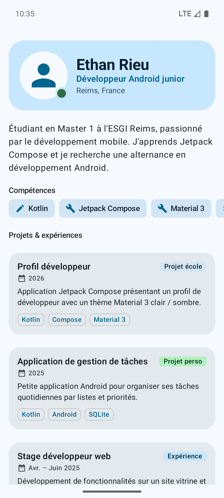
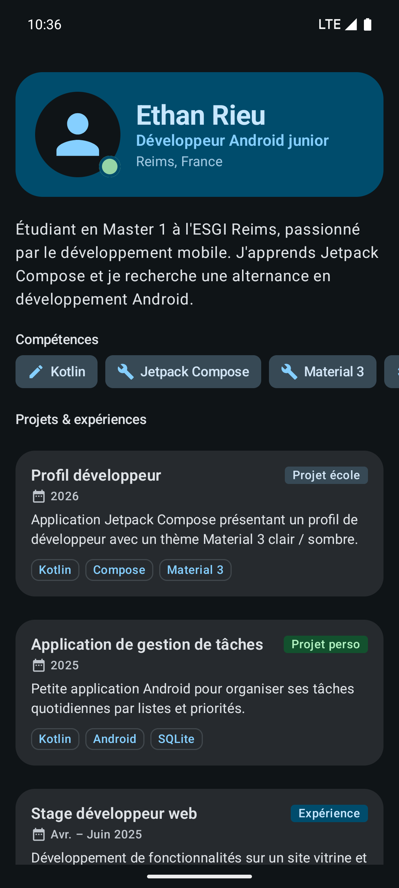
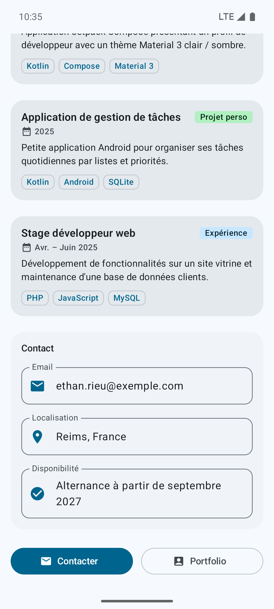
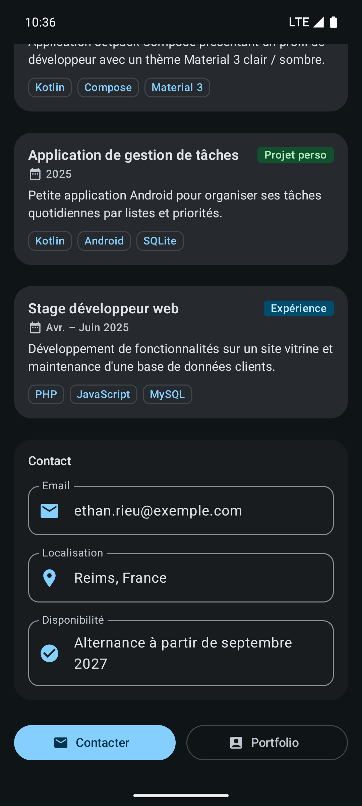

# Profil développeur — Amélioration UI

Devoir ESGI M1 — Développement Android avec Jetpack Compose — Ethan Rieu (Reims)

## Description

C'est la suite de ma première fiche « Profil développeur ». J'ai repris le projet pour en faire un vrai petit écran de profil, plus complet et plus propre.

On y retrouve mon nom, mon rôle, une courte description, un avatar avec un badge de disponibilité, mes compétences, mes projets et expériences, une zone de contact et deux boutons d'action (« Contacter » et « Portfolio »). Les boutons ne font rien de réel pour l'instant, leurs callbacks sont vides.

Toutes les données sont écrites directement en Kotlin dans `model/DeveloperProfile.kt`. Il y a deux profils : le mien et un profil fictif (Camille, full-stack, non disponible) pour tester les composables avec d'autres données.

## Captures

| Clair | Sombre |
|---|---|
|  |  |
|  |  |

## Composants Compose utilisés

- `Text` pour tous les textes (nom, rôle, descriptions, titres de section…)
- `Button` pour l'action principale « Contacter », et `OutlinedButton` pour « Portfolio »
- `Icon` dans les pastilles de compétences, les cartes projet (calendrier), les champs de contact et les boutons
- `Image` pour l'avatar (un vector drawable teinté avec la couleur du thème)
- `Card` pour les projets et expériences (`ProjectCard`)
- `OutlinedTextField` en lecture seule pour l'email, la localisation et la disponibilité (`ContactField`)
- `Scaffold` pour la structure de l'écran

## Layouts utilisés

- `Column` pour empiler les éléments verticalement (contenu des cartes, zone de contact…)
- `Row` pour aligner sur une même ligne : avatar + nom dans l'en-tête, titre + type de projet, icône + texte, les deux boutons
- `Box` pour superposer le badge de disponibilité sur l'avatar
- `Spacer` pour gérer les espaces entre les éléments
- `Surface` pour l'en-tête (fond bleu), la zone de contact et les petites pastilles

## Les listes (LazyColumn et LazyRow)

L'écran entier est une `LazyColumn`. Chaque section de la fiche (en-tête, description, compétences, projets, contact, actions) est un `item`, et les projets sont ajoutés avec `items(profile.projects)` : un élément par projet, affiché avec `ProjectCard`. Ça permet à l'écran de défiler et de ne composer que ce qui est visible.

Les compétences sont dans une `LazyRow` horizontale. Chaque compétence est affichée avec `SkillChip`, une pastille avec une icône qui dépend de la catégorie (langage, framework, outil, base de données). J'ai fait en sorte que la `LazyRow` aille jusqu'au bord de l'écran, comme ça on voit la pastille suivante dépasser et on comprend qu'on peut faire défiler.

## Choix du thème

J'ai remplacé les violets du template par ma propre palette Material 3 :

- un **bleu océan** en couleur principale, qui fait sérieux et reste lisible ;
- un **bleu-gris** comme couleur secondaire, plus neutre, pour les pastilles ;
- un **vert** en tertiaire, que je garde pour ce qui est positif (le badge « disponible », les projets perso).

Chaque couleur a sa version claire et sombre, et j'ai aussi défini les couleurs de surface (`surfaceContainer…`) pour que les cartes et les zones ne gardent pas la teinte violette par défaut.

J'ai aussi personnalisé la typographie (`Type.kt`) et les formes (`Shape.kt`) : petits arrondis pour les pastilles, plus grands pour les cartes et l'en-tête. Tout passe par `MaterialTheme.colorScheme`, `MaterialTheme.typography` et `MaterialTheme.shapes`.

Le thème suit le mode clair / sombre du téléphone. J'ai désactivé les couleurs dynamiques d'Android 12+ par défaut, sinon l'appli prend les couleurs du fond d'écran et perd son identité.

## Previews

- `ProfileScreen.kt` : l'écran complet en clair, en sombre, et le profil full-stack en entier.
- `ProfileComponentsPreviews.kt` : une preview par composant (`ProfileHeader`, `AvatarWithBadge`, `SkillChip`, `ProjectCard`, `ContactField`, `ProfileActions`), chacune en clair et en sombre avec `@PreviewLightDark`.

## Quelles notions du chapitre Compose UI avez-vous réutilisées dans cette application ?

J'ai réutilisé à peu près tout le chapitre. Les composants de base (`Text`, `Button`, `Icon`, `Image`, `Card`, `OutlinedTextField` en lecture seule), les layouts (`Column`, `Row`, `Box`, `Spacer`, `Surface`), les listes modernes avec une `LazyColumn` pour l'écran et une `LazyRow` pour les compétences, et des cartes réutilisables comme `ProjectCard` et `SkillChip`.

Côté Material Design 3, j'ai personnalisé les couleurs, la typo et les formes, avec un rendu clair et un rendu sombre. Et j'ai gardé les bonnes pratiques du premier devoir : composables qui reçoivent leurs données en paramètres, un `modifier` sur chaque composable, des callbacks pour les clics et des previews.

## Lancer le projet

1. Ouvrir le dossier dans Android Studio.
2. Attendre la synchronisation Gradle.
3. Lancer la configuration `app` sur un émulateur, ou ouvrir `ProfileScreen.kt` / `ProfileComponentsPreviews.kt` en mode *Split* pour voir les previews.
